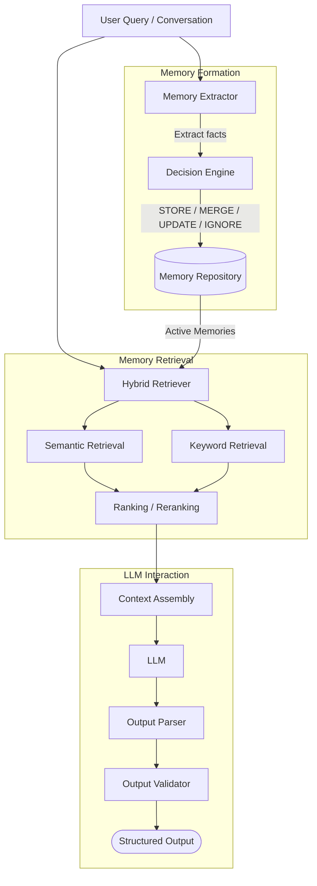

# ChunkdUp

> **An experimental memory runtime for AI agents , built from scratch to understand what it actually means for a machine to remember.**

Yes, I named it ChunkdUp purely because it sounded cool in my head. There is no deeper meaning. Don't look for one.

I'm building this because I don't want to treat "AI memory" as a magical API call.

When we say an agent "remembers" something, several different problems are hiding underneath:

- What information is actually worth remembering?
- What should happen when the same information appears again?
- What happens when a new fact contradicts an old one?
- How do we persist memory without turning the database into a dump of everything the user ever said?
- How do we retrieve the right memory when the user's query is vague, incomplete, or indirect?
- How do we know whether the memory system is actually working?

ChunkdUp is my attempt to answer these questions by building the underlying pieces myself, testing them, and keeping track of where the system still fails.

---

## V1: What We Have Built

V1 focuses primarily on **memory formation, state management, persistence, and establishing a measurable retrieval baseline**.

The core idea is simple:

```text
Conversation
     │
     ▼
Extract useful information
     │
     ▼
Memory Decision
     │
     ├── STORE
     ├── MERGE
     ├── UPDATE
     └── IGNORE
     │
     ▼
Persistent Memory
     │
     ▼
Retrieval
     │
     ▼
Relevant Context
````

Rather than treating every conversation as something that should automatically become memory, ChunkdUp makes the memory lifecycle explicit.

### Example

```text
"I use Python."
        ↓
      STORE

"I use Python."
        ↓
      MERGE

"I switched my backend to Go."
        ↓
      UPDATE

"It's raining today."
        ↓
      IGNORE
```

The result is not just a collection of vectors.

It is a piece of state that can evolve over time.

---

# The Journey So Far : The Messy Labs

ChunkdUp started as a collection of small experiments. Each lab explored a problem that eventually became part of the larger system.

## Lab 001 : The Constraint Problem

**How do we decide what information survives when context is limited?**

[Read Lab 001](learnings/lab001/leanings_001.md)

Explored:

* context constraints
* keyword-based selection
* semantic similarity
* greedy budget packing

The first lesson was simple:

> Matching words isn't the same as matching meaning.

---

## Lab 002 : The Trust Problem

**How do we safely consume output from a probabilistic model?**

[Read Lab 002](learnings/lab002/learnings_002.md)

Explored:

* structured JSON output
* schema validation
* regex fallback parsing
* intentional rejection
* handling malformed model output

The goal was not to make the LLM magically reliable.

It was to make the system **safe when the LLM isn't reliable**.

---

## Lab 003 : The State Problem

**How should memory evolve when new information arrives?**

[Read Lab 003](learnings/lab003/lab3_complete_overview.md)

This became the core of ChunkdUp's memory lifecycle.

The system explicitly handles:

```text
STORE
MERGE
UPDATE
IGNORE
```

and maintains memory state rather than blindly accumulating new records.

This is also where the project moved from being a collection of experiments toward becoming an actual memory runtime.

---

## Lab 004 : The Semantic Memory Pipeline

**How do we turn stored memory into useful context for an AI system?**

[Read Lab 004](learnings/lab004/learnings_004.md)

This connected the pieces:

```text
User Query
     ↓
Memory Retrieval
     ↓
Context Assembly
     ↓
LLM
     ↓
Structured Output
```

The system could now retrieve dynamic user state and use it as part of an AI interaction.

---

# V1 Architecture

The current V1 architecture looks like this:



The important architectural separation is:

```text
Memory Formation
       ≠
Memory Retrieval
       ≠
LLM Generation
```

Each stage has a different responsibility.

---

# V1 Evaluation

One of the main goals of V1 was to make the memory lifecycle **testable rather than anecdotal**.

### Memory Policy

Current policy benchmark:

```text
54 / 54 scenarios passed
100% policy accuracy
```

The benchmark covers decisions such as:

* new information → STORE
* repeated information → MERGE
* changed information → UPDATE
* irrelevant information → IGNORE

### Retrieval Baseline

The current retrieval benchmark establishes a baseline for V2:

```text
MRR              0.7857
Mean Recall@K    0.8571
Mean Precision@K 0.3821
```

These numbers are intentionally treated as a **baseline**, not as a claim that retrieval is solved.

For example, the system can successfully retrieve relevant memories for queries such as:

```text
"What programming languages do I use?"
"What editor or IDE do I prefer?"
"What is my tech stack?"
```

while still struggling with cases such as:

```text
"What is the weather forecast today?"
```

where the correct behavior should be:

```text
[]
```

rather than returning an unrelated memory.

That failure is important.

It tells us that retrieval is not simply:

> "Find the most similar memory."

The system also needs to determine:

> **"Is any stored memory relevant enough to return at all?"**

---

# What V1 Taught Me

The biggest lesson from V1 is that AI memory is not one problem.

It is a chain of problems:

```text
Should I remember this?
        ↓
What exactly should I remember?
        ↓
How does this memory change?
        ↓
How should I persist it?
        ↓
Which memories are relevant later?
        ↓
Is the retrieved memory actually relevant?
        ↓
How should the agent use it?
```

Getting one layer right does not automatically make the entire system reliable.

---

# V2 : The Semantic Retrieval Problem

V1 established the memory lifecycle and gave us a working retrieval baseline.

The next stage is intentionally focused on **semantic retrieval**.

This is where the problem gets considerably harder.

Humans rarely write perfectly explicit queries.

We say things like:

```text
"What was that database again?"

"What did we decide?"

"Use the same thing as last time."

"Where do I run this?"

"Okay, let's continue."
```

The relevant memory may not share obvious keywords with the query.

The query may also be:

* short
* vague
* incomplete
* indirect
* context-dependent
* ambiguous
* completely unrelated to stored memory

So V2 will investigate how ChunkdUp can distinguish between:

```text
Relevant memory
        vs.
Semantically similar but irrelevant memory
        vs.
No relevant memory
```

### Areas to investigate

The V2 research pipeline will explore these questions incrementally:

```text
Query
  ↓
Query understanding
  ↓
Candidate generation
  ↓
Semantic retrieval
  ↓
Keyword / entity signals
  ↓
Ranking
  ↓
Relevance decision
  ↓
Final memories
```

Potential areas of experimentation include:

* contextual memory representations
* query rewriting
* entity-aware retrieval
* hybrid retrieval strategies
* adaptive retrieval depth
* relevance thresholds
* reranking
* out-of-domain rejection
* ambiguous and indirect queries
* evaluation across different query categories

The important rule for V2:

> **No new retrieval component gets added simply because it sounds interesting. It needs a concrete failure case and a benchmark that can tell us whether it actually helped.**

---

# Project Philosophy

ChunkdUp is intentionally being built incrementally.

I don't want the project to become a collection of every technique that exists in the AI-memory ecosystem.

The process is:

```text
Build
  ↓
Measure
  ↓
Find a failure
  ↓
Understand the failure
  ↓
Change one thing
  ↓
Measure again
```

If something works, keep it.

If something fails, understand why.

If a more complicated architecture does not solve a demonstrated problem, don't add it.

---

# Current Status

### V1 - Memory Runtime

* [x] Memory extraction
* [x] Deterministic memory policy
* [x] STORE / MERGE / UPDATE / IGNORE
* [x] Memory repository abstraction
* [x] Persistent storage
* [x] PostgreSQL + pgvector
* [x] Memory history
* [x] Optimistic locking
* [x] Hybrid retrieval baseline
* [x] Entity-aware retrieval experiments
* [x] Evaluation harness
* [x] Memory policy benchmark
* [x] Retrieval benchmark
* [x] Basic observability metrics

### V2 - Semantic Retrieval

* [ ] Improve vague-query retrieval
* [ ] Improve contextual retrieval
* [ ] Improve out-of-domain rejection
* [ ] Investigate contextual memory representations
* [ ] Evaluate query rewriting
* [ ] Evaluate entity-aware retrieval
* [ ] Improve relevance filtering
* [ ] Benchmark retrieval failure categories
* [ ] Compare retrieval strategies systematically

---

# Why I'm Building This

I'm not trying to claim that ChunkdUp has solved AI memory.

Quite the opposite.

The interesting part is discovering **where the simple solution stops working**.

V1 gave me a working memory lifecycle and a measurable baseline.

V2 is about understanding the harder question:

> **When a human asks an AI something vague, how does the system figure out which piece of its past actually matters?**

That's the next problem I'm going after.
```
